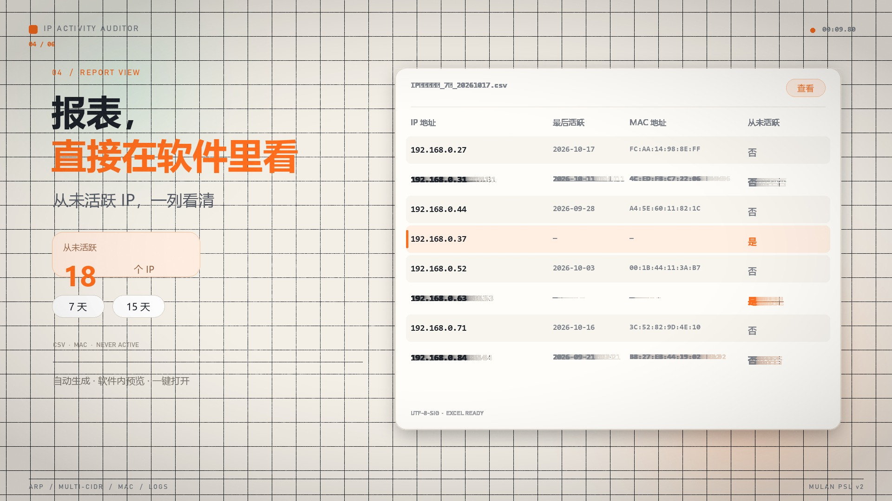

# 内网 IP 活跃度审计工具（IP Activity Auditor）

[](https://github.com/miralexand/IPActivityAuditor/actions/workflows/build.yml)
[](LICENSE)

通过 ARP 扫描指定内网网段，记录每个 IP 的最后活跃日期、MAC 地址和从未活跃状态，并生成“7 天未使用”“15 天未使用”的 CSV 清单。提供明亮橙色主题的现代图形界面、托盘静默运行、报表内置查看、日志查询和完整命令行模式。

> **授权使用声明**：本工具仅可用于你拥有管理权限、且已获得明确授权的内网。程序只扫描 `config.ini` 中配置的 CIDR，不会自动扩展网段。请勿用于未经授权的网络探测。

## 宣传视频

[](media/IPActivityAuditor-promo-15s.mp4)

15 秒快节奏动态图形短片，展示多网段扫描、MAC 审计、内置报表、日志查询和托盘静默运行。

- [播放 / 下载 MP4](media/IPActivityAuditor-promo-15s.mp4)
- [查看分镜预览](media/ipaa-promo-contact-sheet.jpg)
- 生成脚本：`tools/make_promo_video.py`

## 功能亮点

- **多网段扫描**：一个配置中可填写多个 CIDR，逐网段探测并汇总结果
- **MAC 地址记录**：扫描时记录在线设备的 MAC 地址，库存和报表均可查看
- **报表内置查看**：报表中心自动预览最新报表，显示总数和“从未活跃”数量
- **从未活跃标识**：报表新增 `never_active` 列，明确标记自审计开始以来从未活跃的 IP
- **日志查询**：内置日志页面，支持关键字搜索和 INFO/WARNING/ERROR 过滤
- **托盘静默运行**：关闭窗口隐藏到托盘，支持托盘扫描、报表、退出和开机自启
- **无需 Npcap**：默认使用 Windows 原生 SendARP，普通权限即可运行；Scapy 为可选后端
- **扫描失败不误判**：扫描或保存失败时不会更新任何 IP 的活跃日期
- **现代图形界面**：明亮主题、橙色强调色、大字号、在线率环图、14 天趋势图
- **双版本交付**：安装版（Inno Setup）与免安装便携版（ZIP）
- **自动构建发布**：GitHub Actions 测试、构建并可在打标签时自动创建 Release

## 下载与版本

| 版本 | 文件 | 说明 |
| --- | --- | --- |
| 安装版 | `IPActivityAuditor-Setup-0.5.0.exe` | 安装到 `Program Files`，创建开始菜单/桌面快捷方式，可选创建每日任务 |
| 便携版 | `IPActivityAuditor-portable-0.5.0.zip` | 解压后直接运行，数据保存在程序目录 |
| 单文件 | `IPActivityAuditor.exe` | 可直接运行，适合自行部署 |

构建产物可从以下位置获取：

- GitHub **Releases**：推送 `v*` 标签后自动生成
- GitHub **Actions → Build → Artifacts**：每次构建均上传 `IPActivityAuditor-windows`

安装版数据目录：

```text
C:\ProgramData\IPActivityAuditor\
├─ config.ini
├─ run_scan.cmd
├─ data\ip_activity.db
├─ reports\
└─ logs\ip_activity_auditor.log
```

便携版数据保存在程序所在目录，请放在可写位置。

## 环境要求

- Windows 10/11（64 位）
- 默认 SendARP 后端无需管理员权限
- Scapy 后端需要管理员权限和 [Npcap](https://npcap.com/)（勾选 WinPcap 兼容模式）
- 安装版安装、SYSTEM 每日任务需要管理员权限
- 源码运行需要 Python 3.11+
- 目标机器需与扫描网段处于同一二层广播域；多网段时每个网段应在本机有对应接口地址，或为目标网段所在大网段的子网

## 快速开始

### 安装版

1. 运行 `IPActivityAuditor-Setup-0.5.0.exe`。
2. 按需勾选“创建桌面快捷方式”和“创建每日自动扫描任务”。
3. 安装完成后启动程序。
4. 进入 **设置**，填写一个或多个扫描网段并保存。
5. 在 **概览** 点击“开始扫描”。

> 关闭窗口后程序会隐藏到系统托盘继续运行，不会直接退出；可从托盘菜单或设置页退出。

### 便携版

1. 解压 `IPActivityAuditor-portable-0.5.0.zip` 到可写目录。
2. 双击 `IPActivityAuditor.exe`。
3. 在 **设置** 中填写网段并保存。
4. 点击“开始扫描”。

### 源码运行

```powershell
py -3.11 -m pip install -r requirements.txt
py -3.11 src\main.py --gui
```

首次运行会自动创建 `config.ini`、`data\`、`reports\` 和 `logs\`。

## 图形界面

| 页面 | 功能 |
| --- | --- |
| **概览** | 库存总数、当前在线、7/15 天未使用、在线率环图、最近扫描、快捷操作 |
| **IP 库存** | 按 IP/MAC 搜索、按在线/离线/从未活跃筛选、查看 MAC、导出 CSV |
| **扫描记录** | 扫描总次数、成功率、近 14 天在线趋势、历次扫描详情 |
| **报表中心** | 自定义天数生成报表、内置预览最新报表、显示从未活跃数量、打开 Excel |
| **日志** | 搜索日志、按 INFO/WARNING/ERROR 过滤、打开日志目录 |
| **设置** | 多网段、扫描后端、超时/重试、路径、权限、托盘自启、每日任务 |

快捷操作：

- **开始扫描**：后台扫描所有配置网段；可勾选“扫描完成后自动生成报表”
- **初始化库存**：按所有配置网段写入 IP，不进行网络扫描
- **生成报表**：使用配置中的天数或报表中心输入的天数
- **F5**：刷新当前页面
- 右下角显示操作结果提示

## 多网段配置

`[scan] cidr` 支持一个或多个网段，使用换行、逗号或分号分隔：

```ini
[scan]
cidr = 192.168.0.0/24
       192.168.1.0/24
       10.10.0.0/24
backend = auto
timeout_ms = 1500
retries = 1
```

规则：

- 只支持 IPv4 规范网段（不能包含主机位）
- 相同网段会自动去重
- 不允许网段之间重叠
- 每个网段必须能通过本机路由/接口进行 ARP 探测；子网可配置其所在的大网段

## 扫描后端

| 后端 | 说明 | 依赖 |
| --- | --- | --- |
| `auto` | Windows 使用 SendARP，其他平台使用 Scapy | 无 |
| `sendarp` | Windows 原生 SendARP 并行探测 | 无需 Npcap，无需管理员 |
| `scapy` | 广播 ARP（目的 MAC `ff:ff:ff:ff:ff:ff`） | Npcap + 管理员权限 |

- SendARP 使用系统 ARP 超时，`timeout_ms` 仅对 Scapy 生效
- `retries` 对两种后端均生效
- 扫描过程中任一网段探测异常会中止本次扫描，避免误判
- 扫描成功后才更新库存；失败只写入失败记录

## MAC 地址与报表

扫描成功时，在线设备的 IP 和 MAC 会写入 `ip_inventory`：

- 在线设备更新 `mac_address`
- 本次未响应但历史有 MAC 的设备保留最后已知 MAC
- 从未活跃设备 MAC 为空

CSV 报表字段：

| 字段 | 说明 |
| --- | --- |
| `ip_address` | IP 地址，按数值自然排序 |
| `last_seen_date` | 最后活跃日期；从未活跃为空 |
| `days_unused` | 距最后活跃天数；从未活跃为空 |
| `mac_address` | 最后已知 MAC 地址；从未活跃为空 |
| `never_active` | 自审计开始以来从未活跃：`是` / `否` |
| `status` | `从未活跃` / `未使用` |

文件示例：

```text
reports/IP未使用清单_7天_YYYYMMDD.csv
reports/IP未使用清单_15天_YYYYMMDD.csv
```

CSV 使用 `utf-8-sig` 编码，Excel 直接打开中文不乱码。报表中心会自动预览最新报表，可在软件内直接查看并显示“从未活跃”数量。

## 日志查询

- 文件：`logs/ip_activity_auditor.log`
- 按大小轮转，单文件 5 MB，保留 5 份
- 记录启动、配置、扫描开始/结果、报表、MAC、异常和退出码
- GUI **日志** 页支持：
  - 关键字搜索
  - 按 `INFO`、`WARNING`、`ERROR` 过滤
  - 查看最近 2000 行
  - 一键打开日志目录

## 托盘静默运行

- **关闭窗口即隐藏到托盘**：后台扫描/报表继续运行
- **静默启动**：`IPActivityAuditor.exe --tray --config "配置文件路径"`
- **托盘菜单**：打开主界面、立即扫描、生成报表、退出
- **后台通知**：隐藏状态下扫描或报表完成后发送托盘通知
- **开机自启**：设置页勾选“开机自动启动（静默到托盘）”，写入当前用户 `HKCU\Software\Microsoft\Windows\CurrentVersion\Run`
- **彻底退出**：托盘菜单“退出”或设置页“退出程序”
- **单实例**：重复启动会唤出已运行窗口

> 便携版移动目录后，请重新勾选一次开机自启。无人值守的每日扫描仍建议使用任务计划（SYSTEM 最高权限）。

## 命令行

带参数启动时进入命令行模式；不带参数打开图形界面；`--gui` / `--tray` 打开图形界面。

```powershell
IPActivityAuditor.exe --gui
IPActivityAuditor.exe --tray --config "C:\ProgramData\IPActivityAuditor\config.ini"
IPActivityAuditor.exe --config config.ini
IPActivityAuditor.exe --scan
IPActivityAuditor.exe --report --days 7,15
IPActivityAuditor.exe --init
IPActivityAuditor.exe --version
```

| 参数 | 说明 |
| --- | --- |
| `--gui` | 打开图形界面 |
| `--tray` | 启动图形界面并隐藏到系统托盘 |
| `--config PATH` | 配置文件路径 |
| `--init` | 初始化所有配置网段的 IP 库存 |
| `--scan` | 扫描所有配置网段并保存结果 |
| `--report` | 生成未使用 IP 报表 |
| `--days 7,15` | 覆盖配置中的报表天数 |
| `--version` | 显示版本号 |

行为约定：

- 无参数时打开图形界面
- `--config` 单独使用等同于“扫描 + 生成配置中的报表”
- 扫描失败时跳过报表并返回非 0
- 相对路径以配置文件所在目录为基准

## 配置说明

```ini
[scan]
cidr = 192.168.0.0/24
backend = auto
timeout_ms = 1500
retries = 1

[storage]
db_path = data/ip_activity.db

[report]
report_dir = reports
unused_days = 7,15

[log]
log_dir = logs
```

- `cidr`：一个或多个 IPv4 规范网段
- `backend`：`auto` / `sendarp` / `scapy`
- `timeout_ms`：Scapy 等待超时（毫秒）
- `retries`：未响应主机重试次数
- `unused_days`：报表天数列表
- 所有日期使用本地时区，格式 `YYYY-MM-DD`

图形界面“设置”页保存时会进行完整校验；非法或不重叠网段不会写入。

## 数据库

`ip_inventory`：

| 字段 | 说明 |
| --- | --- |
| `ip_address` | 主键 |
| `cidr` | 所属网段 |
| `first_seen_date` | 首次在线日期 |
| `last_seen_date` | 最后在线日期，可为空 |
| `last_status` | `online` / `offline` |
| `mac_address` | 最后已知 MAC 地址 |
| `updated_at` | 本地时间戳 |

`scan_runs`：每次扫描的日期、CIDR 列表、在线数、耗时、状态和错误。

`daily_online`：每日在线历史，用于趋势图。

旧数据库启动时会自动补充 `mac_address` 列，无需手工迁移。

## 退出码

| 退出码 | 含义 |
| --- | --- |
| `0` | 成功 |
| `1` | 一般错误 |
| `2` | Scapy 后端缺少管理员权限 |
| `3` | 配置错误 |
| `4` | 扫描失败（未更新活跃日期） |
| `5` | 报表生成失败 |

## 构建

```powershell
py -3.11 -m pip install -r requirements.txt
.\build.ps1
```

脚本会安装依赖、生成图标、构建单文件 exe、便携 ZIP 和 Inno Setup 安装版。CI 中可指定 Python：

```powershell
.\build.ps1 -SkipInstall -PythonExe python
```

构建安装版需要 [Inno Setup 6](https://jrsoftware.org/isinfo.php)；便携 ZIP 可选 7-Zip。

### GitHub Actions

工作流：`.github/workflows/build.yml`

- 推送到 `main`、PR 或手动触发：21 项测试 + 构建三个产物 + 上传 Artifacts
- 推送 `v*` 标签：自动创建 GitHub Release，附带 exe、安装版和便携 ZIP

发布新版本：

```powershell
git tag v0.5.0
git push origin v0.5.0
```

## 任务计划程序

### 程序内创建

**设置 → 每日自动扫描**，设置时间后点击“创建 / 更新任务”。需要管理员权限。

### 安装时创建

安装时勾选“创建每日自动扫描任务”，安装程序会创建 `IPActivityAuditor` 任务，每天 23:30 以 SYSTEM 最高权限运行。

### PowerShell 脚本

```powershell
.\install_task.ps1 -ExePath .\dist\IPActivityAuditor.exe -ConfigPath .\dist\config.ini -Time 23:30
```

无人值守任务使用 CLI 模式，不启动托盘，不显示窗口。

## 测试

```powershell
py -3.11 -m unittest discover -s tests -v
```

测试覆盖：多网段配置、重叠校验、SendARP 多网段、MAC 记录、数据库迁移、失败不更新活跃日期、7/15 天判定、`never_active` 列、自然排序、CSV 编码和文件名。

## 常见问题

- **点击菜单不跳转**：已在 0.3.2 修复；当前版本使用显式页面显示/隐藏
- **关闭窗口后程序不见了**：已隐藏到托盘，双击托盘图标恢复
- **如何彻底退出**：托盘菜单“退出”或设置页“退出程序”
- **扫描结果为 0**：检查本机是否有对应网段地址、是否在同一 ARP 广播域；子网可配置其所在大网段
- **提示网段不合法**：CIDR 不能包含主机位，多个网段不能重叠
- **MAC 为空**：设备从未在线，或当前扫描后端未返回 MAC
- **Scapy/Npcap 报错**：仅 `backend = scapy` 需要 Npcap；可改用 `auto` 或 `sendarp`
- **安装版配置在哪里**：`C:\ProgramData\IPActivityAuditor\config.ini`
- **便携版无法写数据**：移动到可写目录，例如 `D:\Tools\IPActivityAuditor`
- **杀毒软件误报**：单文件 PyInstaller 程序可能被误报，请加白名单或签名

## 目录结构

```text
IPAA/
├─ .github/workflows/build.yml   # GitHub Actions 构建与 Release
├─ src/
│  ├─ main.py                    # 入口、CLI/GUI 分发、日志、流程
│  ├─ gui.py                     # 图形界面、托盘、日志查询
│  ├─ config.py                  # 多网段配置解析与校验
│  ├─ scanner.py                 # SendARP/Scapy 多网段扫描与 MAC
│  ├─ db.py                      # SQLite、MAC 迁移、多网段查询
│  ├─ report.py                  # CSV 报表（MAC、never_active）
│  ├─ apputil.py                 # 路径、提权、单实例、控制台
│  └─ version.py                 # 版本
├─ tests/
├─ assets/
├─ installer/
├─ tools/
├─ build.ps1
├─ install_task.ps1
├─ config.ini.example
├─ requirements.txt
├─ LICENSE
└─ README.md
```

## 开源许可

Copyright (c) 2026 miralexand

本项目采用 **木兰宽松许可证，第 2 版（Mulan PSL v2）** 开源，详见 [LICENSE](LICENSE)。

你可以在许可证条款下自由使用、修改和分发本软件；分发时请保留许可证副本及版权、商标、专利和免责声明。

> Npcap 是 Nmap 项目的独立软件，不在本项目许可范围内；仅在使用可选 Scapy 后端时需要自行安装并遵守其许可。
